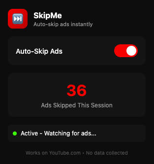

<h1 align="center">SkipMe</h1>

<p align="center">
  A focused Chrome extension that automatically activates YouTube's skip button when it appears.
</p>

<p align="center">
  
  
  
  
</p>

<p align="center">
  <a href="#overview">Overview</a>
  ·
  <a href="#getting-started">Getting Started</a>
  ·
  <a href="#project-structure">Project Structure</a>
  ·
  <a href="#permissions">Permissions</a>
</p>

<br />

<p align="center">
  
</p>

## Overview

SkipMe is a lightweight Chrome extension for YouTube. It watches for the native **Skip** button, identifies the active control, and activates it automatically when an advertisement can be skipped.

The extension includes:

- A minimal popup for enabling or disabling automatic skipping
- A locally stored skipped-ad counter
- MutationObserver and interval-based detection for YouTube's dynamic interface
- Support for YouTube single-page navigation
- A visible, temporary status label during skip activity
- A Manifest V3 service worker for trusted mouse input

SkipMe does not block advertisements or modify video content. It activates YouTube's own skip control when that control becomes available.

## Tech stack

- **Chrome Extensions Manifest V3** — extension architecture and permissions
- **Vanilla JavaScript** — content script, popup, and service worker logic
- **Chrome Debugger API** — trusted mouse input at the detected button coordinates
- **Node.js** — dependency-free packaging script

## Requirements

- Google Chrome or a Chromium-based browser
- Node.js with npm
- A YouTube account and access to `youtube.com`

## Getting started

### 1. Install dependencies

```bash
npm install
```

The project has no runtime dependencies. This command keeps the npm project metadata ready for local development.

### 2. Build the extension

```bash
npm run build
```

The extension-only package is generated in `dist/`.

### 3. Load the unpacked extension

1. Open `chrome://extensions`.
2. Enable **Developer mode**.
3. Click **Load unpacked**.
4. Select the project's `dist/` folder.
5. Open a new YouTube tab and play a video with an advertisement.

After source changes, run `npm run build` and click **Reload** on SkipMe in `chrome://extensions`.

## Available scripts

| Command | Description |
| --- | --- |
| `npm run build` | Copy the extension source into a clean `dist/` package |

## Project structure

```text
.
├── public/
│   └── extension/
│       ├── background.js       # Trusted mouse-input service worker
│       ├── content.js         # Skip-button detection and coordination
│       ├── manifest.json       # Manifest V3 configuration
│       ├── popup.html          # SkipMe popup interface
│       ├── popup.js            # Popup state and statistics
│       ├── preview.png         # Packaged extension preview
│       └── README.md           # Packaged extension documentation
├── scripts/
│   └── build-extension.mjs     # Extension packaging script
├── preview.png                 # Repository README preview
├── package.json                # Project metadata and scripts
└── dist/                       # Generated unpacked extension package
```

## How it works

1. `content.js` observes YouTube's page for an enabled skip button.
2. The button's center coordinates are sent to `background.js`.
3. The service worker uses `chrome.debugger` and Chrome DevTools Protocol mouse events to activate the control.
4. The content script updates the local counter and temporary status label.

## Permissions

| Permission | Purpose |
| --- | --- |
| `storage` | Stores the enabled state and skipped-ad count locally |
| `debugger` | Sends trusted mouse input to the detected YouTube skip button |

Chrome displays a security banner while the debugger permission is active. This is required by Chrome and cannot be customized by the extension.

## Privacy

SkipMe runs locally in the browser. It does not collect, transmit, or sell browsing data. The only stored values are the extension's enabled state and skipped-ad count in Chrome local storage.

## Customization

- Update the button selectors and detection behavior in [`public/extension/content.js`](public/extension/content.js).
- Update the trusted input flow in [`public/extension/background.js`](public/extension/background.js).
- Update popup layout and branding in [`public/extension/popup.html`](public/extension/popup.html).
- Update popup state handling in [`public/extension/popup.js`](public/extension/popup.js).
- Update extension metadata in [`public/extension/manifest.json`](public/extension/manifest.json).

## Limitations

- SkipMe currently targets `youtube.com`.
- It does not block ads before they load.
- The debugger permission produces a Chrome security notification.
- YouTube can change its internal DOM or interaction behavior at any time.

## Quality check

```bash
npm run build
```

The build creates a clean `dist/` directory containing only the files needed to load SkipMe as an unpacked Chrome extension.
